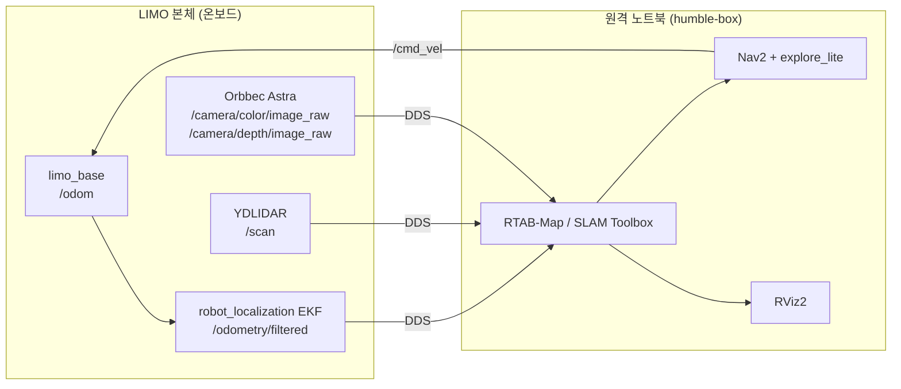

<div align="center">

# 🤖 LIMO 자율주행 및 다중 센서 융합 SLAM 캡스톤 프로젝트

**AgileX LIMO (Ackermann) 기반 · 2D LiDAR + Depth 카메라 융합 SLAM · 미지 환경 자율 탐색 매핑**


</div>

---

## 📑 목차
1. [프로젝트 개요](#1-프로젝트-개요-project-overview)
2. [시스템 사양 및 기술 스택](#2-시스템-사양-및-기술-스택-system--tech-stack)
3. [저장소 디렉터리 구조](#3-저장소-디렉터리-구조-directory-tree)
4. [설치 및 빌드 환경 구성](#4-설치-및-빌드-환경-구성-prerequisites--build)
5. [실행 가이드](#5-실행-가이드-operation-guide)
6. [상세 문서](#6-상세-문서-documentation)
7. [Git 워크플로우 및 협업 규칙](#7-git-워크플로우-및-협업-규칙-branching-strategy)
8. [라이선스](#8-라이선스)

---

## 1. 프로젝트 개요 (Project Overview)

| 항목 | 내용 |
|------|------|
| **프로젝트명** | LIMO 자율주행 및 다중 센서 융합 SLAM 캡스톤 프로젝트 |
| **플랫폼** | AgileX LIMO (Ackermann 기구학) |
| **메인 패키지** | `limo_capstone` (ament_python) |

### 핵심 기능
- **2D LiDAR + Depth 카메라 융합 SLAM (RTAB-Map)**
  - `/scan`(LiDAR)과 `/camera/color/image_raw`, `/camera/depth/image_raw`(RGB-D)를 근사 동기화하여 융합.
  - 정합은 ICP(`Reg/Strategy: 1`), 점유 격자는 LiDAR 스캔 기반(`Grid/FromDepth: false`)으로 생성.
- **미지의 환경 자율 탐색 및 2D 점유 격자 지도(Occupancy Grid) 구축**
  - Nav2(주행) + `explore_lite`(프론티어 탐색) + SLAM Toolbox(온라인 비동기 매핑)를 한 번에 실행하여 로봇이 스스로 지도를 작성.
  - 저장된 정적 지도 기반 Nav2 주행(AMCL + map_server)도 지원.
- **EKF 기반 오도메트리 보정 및 분산 연산 파이프라인**
  - `robot_localization` EKF가 휠 오도메트리(`/odom`)와 IMU를 융합하여 `/odometry/filtered` 발행.
  - **LIMO 본체**는 하드웨어 구동/센서 드라이버/EKF, **원격 노트북**은 SLAM·Nav2·RViz2 연산을 담당 (ROS 2 DDS 통신, `ROS_DOMAIN_ID=30`).



---

## 2. 시스템 사양 및 기술 스택 (System & Tech Stack)

| 구분 | 사양 |
|------|------|
| **OS** | Ubuntu 22.04 LTS (Distrobox 컨테이너 `humble-box` 환경) |
| **Middleware** | ROS 2 Humble |
| **RMW** | `rmw_fastrtps_cpp` (FastRTPS, `fastdds.xml` 프로파일 사용 · UDPv4 전송) |
| **Hardware** | AgileX LIMO, YDLIDAR, Orbbec Astra RGB-D Camera |
| **Core Packages** | `nav2_bringup`, `explore_lite`, `rtabmap_ros`, `robot_localization` |
| **보조 패키지** | `slam_toolbox`, `limo_ros2`, `ydlidar_ros2_driver`, `ros2_astra_camera`, `wego` |

### 주요 토픽

| 토픽 | 타입 | 발행/사용 |
|------|------|-----------|
| `/scan` | `sensor_msgs/LaserScan` | YDLIDAR → SLAM, costmap, AMCL |
| `/camera/color/image_raw` | `sensor_msgs/Image` | Astra 컬러 영상 → RTAB-Map |
| `/camera/depth/image_raw` | `sensor_msgs/Image` | Astra 깊이 영상 → RTAB-Map |
| `/camera/color/camera_info` | `sensor_msgs/CameraInfo` | 카메라 내부 파라미터 → RTAB-Map |
| `/odom` | `nav_msgs/Odometry` | `limo_base` 휠 오도메트리 |
| `/odometry/filtered` | `nav_msgs/Odometry` | EKF 융합 오도메트리 → RTAB-Map |
| `/map` | `nav_msgs/OccupancyGrid` | SLAM / map_server 지도 |
| `/cmd_vel` | `geometry_msgs/Twist` | Nav2 → 로봇 속도 명령 |

---

## 3. 저장소 디렉터리 구조 (Directory Tree)

이 저장소는 ROS 2 워크스페이스(`~/capstone_ws`)의 `src/` 디렉터리 자체입니다.

```text
limo_workspace/                    # = ~/capstone_ws/src
├── README.md                      # 프로젝트 소개 (현재 문서)
├── docs/                          # 프로젝트 문서
│   ├── setup_guide.md             # 초기 세팅 및 실행 가이드
│   ├── troubleshooting.md         # 하드웨어/TF/네트워크 에러 대응 일지
│   ├── tuning_log.md              # Nav2/Costmap/SLAM 파라미터 튜닝 기록
│   ├── 2026_10_15                 # 개발 일지 (2026-10-15)
│   └── 2026_10_21                 # 개발 일지 (2026-10-21)
│
├── limo_capstone/                 # ★ 캡스톤 메인 패키지 (ament_python)
│   ├── setup.py                   # launch/config/maps를 share 디렉터리로 설치
│   ├── package.xml                # 패키지 메타데이터
│   ├── launch/
│   │   ├── limo_light.launch.py        # 최소 HW 구동: limo_base + URDF TF + YDLIDAR
│   │   ├── limo_auto_mapping.launch.py # SLAM Toolbox + Nav2 + explore_lite 자율 탐색 매핑
│   │   ├── limo_rtabmap.launch.py      # RTAB-Map RGB-D + 2D LiDAR 융합 SLAM
│   │   └── limo_nav2.launch.py         # 저장된 정적 지도 기반 Nav2 주행 (AMCL)
│   ├── config/
│   │   ├── nav2_explore_params.yaml    # LIMO 튜닝 Nav2 파라미터 (AMCL/Costmap/Controller)
│   │   ├── explore.yaml                # explore_lite 프론티어 탐색 파라미터
│   │   └── slam_params.yaml            # SLAM Toolbox 파라미터
│   ├── maps/                      # 저장된 지도 (*.yaml + *.pgm/png)
│   │   ├── map_limo.yaml               # limo_nav2 기본 지도
│   │   ├── MC3F_room_map.yaml          # MC관 3층 실내 지도
│   │   ├── MC_3F_10_15.yaml            # MC관 3층 지도 (10/15)
│   │   ├── MC_2F_10_07.yaml            # MC관 2층 지도 (10/07)
│   │   ├── demo_map.yaml               # 데모용 지도
│   │   └── domi_map.yaml               # 테스트용 지도
│   ├── MC3F_nav2/                 # Nav2 실험 결과 이미지 및 TF 트리(frames_*.pdf/gv)
│   ├── resource/                  # ament 리소스 마커
│   └── rosgraph.png               # ROS 노드/토픽 그래프
│
├── limo_ros2/                     # AgileX LIMO 공식 패키지 (limo_base, limo_description, limo_msgs)
├── wego/                          # 하드웨어 통합 런치 (teleop_launch.py: base+camera+LiDAR+EKF)
├── wego_2d_nav/                   # 2D 내비게이션 예제/파라미터
├── wego_msgs/                     # wego 커스텀 메시지
├── robot_localization/            # EKF/UKF (params/limo_ekf.yaml, launch/limo_ekf_launch.py)
├── m-explore-ros2/                # explore_lite, map_merge (프론티어 자율 탐색)
├── ydlidar_ros2_driver/           # YDLIDAR 드라이버 (/scan)
├── ros2_astra_camera/             # Orbbec Astra 카메라 드라이버
├── libuvc/                        # UVC 라이브러리 (COLCON_IGNORE: 빌드 제외)
├── magic_enum/                    # C++ enum 리플렉션 라이브러리 (의존성)
├── limo_auto_mapping/             # 자율 매핑 실험 패키지
├── limo_mapping_interfaces/       # 자율 매핑 인터페이스
├── limo_mapping_explore_msgs/     # 자율 매핑 탐색 메시지
├── limo_onboard_trials/           # 온보드 탐색/내비게이션 시험 패키지
└── limo_ros2_application/         # LIMO 응용 예제 (move_to_pose, track 등)
```

> 위 트리는 `limo_capstone` 외 서드파티/실험 패키지를 요약해 표기했습니다.
> `fastdds.xml`은 저장소가 아닌 홈 디렉터리(`~/fastdds.xml`)에 두고 환경변수로 참조합니다. ([4.3절](#43-통신-도메인-및-rmw-설정) 참고)

---

## 4. 설치 및 빌드 환경 구성 (Prerequisites & Build)

### 4.1 필수 패키지 설치

Distrobox 컨테이너(`humble-box`) 안에서 진행합니다.

```bash
distrobox enter humble-box

sudo apt update
sudo apt install -y \
  ros-humble-rtabmap-ros \
  ros-humble-navigation2 \
  ros-humble-nav2-bringup \
  ros-humble-slam-toolbox \
  ros-humble-robot-localization \
  ros-humble-rviz2 \
  python3-colcon-common-extensions
```

> `explore_lite`(`m-explore-ros2`), `robot_localization`, LIMO/센서 드라이버는 이 저장소에 소스로 포함되어 있어 함께 빌드됩니다.
> 의존성 일괄 설치: `rosdep install --from-paths src --ignore-src -r -y`

### 4.2 워크스페이스 빌드 및 소싱

```bash
cd ~/capstone_ws
colcon build --symlink-install --packages-select limo_capstone
source install/setup.bash
```

> 처음 클론한 경우에는 의존 패키지(`explore_lite`, `limo_base` 등)까지 한 번 전체 빌드해야 합니다: `colcon build --symlink-install`
> `launch/`, `config/` 수정 후에는 다시 `source install/setup.bash`를 실행해야 반영됩니다.
> ⚠️ `maps/` 폴더 안에서 `colcon build`를 실행하지 마세요. (`build/`, `install/`, `log/`가 생겨 링크가 깨집니다 → [troubleshooting.md](docs/troubleshooting.md#3-maps-폴더-오염-및-심볼릭-링크-깨짐))

### 4.3 통신 도메인 및 RMW 설정

LIMO 본체와 노트북 **양쪽 모두** 동일하게 설정합니다. (`~/.bashrc` 등록 권장)

```bash
export ROS_DOMAIN_ID=30
export RMW_IMPLEMENTATION=rmw_fastrtps_cpp
export FASTRTPS_DEFAULT_PROFILES_FILE=$HOME/fastdds.xml   # UDPv4 전송 프로파일
```

### 4.4 단축어 (alias)

- `teleop` : LIMO 본체에 `ros2 launch wego teleop_launch.py`로 이미 등록되어 있습니다. (본체 `~/.bashrc`)
- `stop` : 비상 정지용. 현재 **노트북**에 등록해 사용하며, LIMO 본체에는 **추후 반영 예정**입니다. 아래 명령으로 등록합니다.

```bash
echo "alias stop='ros2 topic pub --once /cmd_vel geometry_msgs/msg/Twist \"{linear: {x: 0.0, y: 0.0, z: 0.0}, angular: {x: 0.0, y: 0.0, z: 0.0}}\"'" >> ~/.bashrc
source ~/.bashrc
```

---

## 5. 실행 가이드 (Operation Guide)

> 모든 터미널에서 `source ~/capstone_ws/install/setup.bash` 및 `ROS_DOMAIN_ID=30`이 설정되어 있어야 합니다.

### Step 1. 🤖 LIMO 본체 — 하드웨어 브링업

둘 중 목적에 맞는 런치를 선택합니다.

```bash
# (A) 풀 브링업: limo_base + Astra 카메라 + YDLIDAR + EKF (/odometry/filtered 발행)
#     → RTAB-Map 융합 SLAM에 필요
#     LIMO 본체에는 이 명령이 `teleop` alias로 등록되어 있음
teleop
# (alias 미등록 환경에서의 원본 명령)
# ros2 launch wego teleop_launch.py

# (B) 최소 구동: limo_base + URDF TF + YDLIDAR (/scan)
#     → 자율 탐색 매핑(limo_auto_mapping) / 정적 지도 주행(limo_nav2)의 사전 조건
ros2 launch limo_capstone limo_light.launch.py
```

### Step 2. 💻 노트북 — 매핑 / SLAM 실행

#### 2-A. 자율 탐색 매핑 (SLAM Toolbox + Nav2 + explore_lite)
```bash
ros2 launch limo_capstone limo_auto_mapping.launch.py
```
- 로봇이 프론티어(알려진 영역과 미지 영역의 경계)를 찾아 스스로 이동하며 `/map`을 작성합니다.
- 탐색이 끝나거나 중단되면 즉시 지도를 저장합니다.
  ```bash
  ros2 run nav2_map_server map_saver_cli -f ~/capstone_ws/src/limo_capstone/maps/MC3F_room_map
  ```

#### 2-B. RTAB-Map 융합 SLAM (RGB-D + 2D LiDAR)
```bash
ros2 launch limo_capstone limo_rtabmap.launch.py
```
- 입력: `/scan`, `/camera/color/image_raw`, `/camera/depth/image_raw`, `/camera/color/camera_info`, `/odometry/filtered`
- 시작 시 기존 DB(`~/.ros/rtabmap.db`)를 삭제하고(`--delete_db_on_start`) 새 지도를 생성하며, RViz2가 자동 실행됩니다.

#### 2-C. (선택) 저장된 지도 기반 Nav2 주행
```bash
ros2 launch limo_capstone limo_nav2.launch.py map:=$HOME/capstone_ws/src/limo_capstone/maps/map_limo.yaml
```
- `map` 인자를 생략하면 `maps/map_limo.yaml`이 사용됩니다. 실행 후 RViz2의 **2D Pose Estimate**로 초기 위치를 지정해야 합니다.

### Step 3. 🖥️ RViz2 시각화 및 긴급 정지

```bash
rviz2                  # 필요 시 수동 실행 (limo_rtabmap은 자동 실행)
```
- RViz2 **Map → Topic → Durability Policy**를 `Transient Local`로 설정해야 지도가 표시됩니다.
- 그래픽이 깨지면 `LIBGL_ALWAYS_SOFTWARE=1 rviz2`로 실행하세요.

🚨 **긴급 정지** — 이상 동작 시 즉시 실행 (`/cmd_vel`에 0 속도 발행)
```bash
stop
```

---

## 6. 상세 문서 (Documentation)

| 문서 | 설명 |
|------|------|
| [`docs/setup_guide.md`](docs/setup_guide.md) | 상세 환경 구축 가이드 (런치 순서, RViz2 QoS, `stop` 단축어, 지도 저장) |
| [`docs/troubleshooting.md`](docs/troubleshooting.md) | 하드웨어 및 TF/네트워크 에러 대응 일지 |
| [`docs/tuning_log.md`](docs/tuning_log.md) | Nav2/Costmap/SLAM 파라미터 튜닝 기록 |

---

## 7. Git 워크플로우 및 협업 규칙 (Branching Strategy)

| 브랜치 | 역할 | 규칙 |
|--------|------|------|
| `main` | **검증 완료된 릴리즈 브랜치** | 직접 push 금지, **Pull Request 승인 필수** |
| `dev` | **실물 주행 및 기능 개발 브랜치** | 실물 LIMO 주행 테스트 후 기능 단위로 커밋 |

```text
dev (개발·실물 주행 검증) ──── Pull Request (리뷰/승인) ────▶ main (릴리즈)
```

- 커밋 메시지는 `type(scope): 설명` 형식을 권장합니다. (예: `fix(limo_capstone): limo_nav2 런치에 params_file 적용`, `docs: 튜닝 일지 갱신`)
- 실물 주행으로 검증되지 않은 변경은 `main`에 병합하지 않습니다.

---

## 8. 라이선스

- `limo_capstone` 패키지: **Apache-2.0** (`setup.py` 기준)
- 포함된 서드파티 패키지(`limo_ros2`, `wego`, `m-explore-ros2`, `robot_localization`, `ydlidar_ros2_driver` 등)는 각 디렉터리의 라이선스 파일을 따릅니다.

