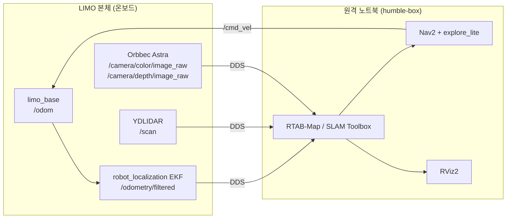

# LIMO 실차 자율주행 및 다중 센서 융합 SLAM

AgileX LIMO로 미지의 실내 공간을 탐색해 지도를 만들고, 저장한 지도를 이용해 목적지까지 주행하는 캡스톤 프로젝트입니다. **이 저장소의 루트가 LIMO의 ROS 2 워크스페이스에서 `src/`에 해당합니다.** 아래 예시는 워크스페이스를 `~/capstone_ws`로 둡니다.

## 최근 변경 및 작업 시작점

`a94bcd8`에서 메인 패키지의 소스 디렉터리를 `limo_capstone_ros/`로 변경했습니다. 빌드와 런치 명령에는 [패키지 선언](limo_capstone_ros/package.xml)의 이름인 `limo_capstone`을 사용합니다.

| 확인할 내용 | 문서 |
|---|---|
| 작업 시작과 인수인계 | [시작 안내](docs/START_HERE.md) · [인수인계](docs/HANDOFF.md) |
| 구현 범위와 실차 시험 근거 | [현재 상태](docs/CURRENT_STATUS.md) · [검증 기록](docs/VALIDATION.md) |
| 노드·런치·설정 위치 | [시스템 구조](docs/ARCHITECTURE.md) · [코드 색인](docs/CODE_INDEX.md) |

## 1. 프로젝트 소개 및 개발 범위

| 운용 목적 | 구성 |
|---|---|
| 미지 공간 자동 탐색 | SLAM Toolbox가 2D 지도를 갱신하고, explore_lite가 탐색 목표를 선택하며, Nav2가 목표까지의 주행을 담당합니다. |
| RGB-D와 LiDAR 융합 매핑 | RTAB-Map이 RGB-D 영상, LiDAR 스캔, EKF 오도메트리를 사용합니다. 런치에는 ICP 정합과 LiDAR 기반 점유 격자 생성이 설정되어 있습니다. |
| 저장 지도 기반 주행 | map_server가 지도를 제공하고 AMCL이 현재 위치를 추정합니다. Nav2가 경로를 계획하고 속도 명령을 발행합니다. |

## 2. 시스템 구성

기존 분산 실행 구성에서 LIMO 본체는 베이스와 센서 드라이버를 실행하고, 원격 노트북은 DDS로 실차 데이터를 받아 SLAM·Nav2·RViz2를 실행합니다. 온보드 통합 실행의 노드 구성은 [실차 통합 런치](limo_capstone_ros/launch/limo_integrated_auto_mapping_real.launch.py)에서 확인할 수 있습니다.

| 구분 | 구성 요소 |
|---|---|
| 플랫폼 | AgileX LIMO, Ackermann 조향, YDLIDAR, Orbbec Astra RGB-D 카메라 |
| 개발 환경 | Ubuntu 22.04, ROS 2 Humble, Python 3.10, 노트북 Distrobox 환경 `humble-box` |
| 통신 | Fast DDS, `rmw_fastrtps_cpp`, 프로젝트 도메인 `30` |
| 위치 추정 | 휠 오도메트리와 IMU를 robot_localization EKF로 융합 |



### 주요 토픽

| 토픽 | 타입 | 발행/사용 |
|

## 3. 저장소 구조

```text
limo_workspace/                    # = ~/capstone_ws/src
├── README.md                      # 프로젝트 소개 (현재 문서)
├── docs/                          # 프로젝트 문서
│   ├── setup_guide.md             # 초기 세팅 및 실행 가이드
│   ├── troubleshooting.md         # 하드웨어/TF/네트워크 에러 대응 일지
│   ├── tuning_log.md              # Nav2/Costmap/SLAM 파라미터 튜닝 기록
│   ├── 2026_10_15                 # 개발 일지 (2026-10-15)
│   └── 2026_10_21                 # 개발 일지 (2026-10-21)
│
├── limo_capstone_ros/                 # ★ 캡스톤 메인 패키지 (ament_python)
│   ├── setup.py                   # launch/config/maps를 share 디렉터리로 설치
│   ├── package.xml                # 패키지 메타데이터
│   ├── launch/
│   │   ├── limo_integrated_auto_mapping_real.launch.py  # 실차 통합 자동 매핑
│   │   ├── limo_light.launch.py        # 최소 HW 구동: limo_base + URDF TF + YDLIDAR
│   │   ├── limo_auto_mapping.launch.py # SLAM Toolbox + Nav2 + explore_lite 자율 탐색 매핑
│   │   ├── limo_rtabmap.launch.py      # RTAB-Map RGB-D + 2D LiDAR 융합 SLAM
│   │   └── limo_nav2.launch.py         # 저장된 정적 지도 기반 Nav2 주행 (AMCL)
│   ├── config/
│   │   ├── nav2_explore_params.yaml    # LIMO 튜닝 Nav2 파라미터 (AMCL/Costmap/Controller)
│   │   ├── explore.yaml                # explore_lite 프론티어 탐색 파라미터
│   │   └── slam_params.yaml            # SLAM Toolbox 파라미터
│   ├── maps/                      # 저장된 지도 (*.yaml + *.pgm/png)
│   │   ├── map_limo.yaml               # limo_nav2 기본 지도
│   │   ├── MC3F_room_map.yaml          # MC관 3층 실내 지도
│   │   ├── MC_3F_10_15.yaml            # MC관 3층 지도 (10/15)
│   │   ├── MC_2F_10_07.yaml            # MC관 2층 지도 (10/07)
│   │   ├── demo_map.yaml               # 데모용 지도
│   │   └── domi_map.yaml               # 테스트용 지도
│   ├── MC3F_nav2/                 # Nav2 실험 결과 이미지 및 TF 트리(frames_*.pdf/gv)
│   ├── resource/                  # ament 리소스 마커
│   └── rosgraph.png               # ROS 노드/토픽 그래프
│
├── limo_ros2/                     # AgileX LIMO 공식 패키지 (limo_base, limo_description, limo_msgs)
├── wego/                          # 하드웨어 통합 런치 (teleop_launch.py: base+camera+LiDAR+EKF)
├── wego_2d_nav/                   # 2D 내비게이션 예제/파라미터
├── wego_msgs/                     # wego 커스텀 메시지
├── robot_localization/            # EKF/UKF (params/limo_ekf.yaml, launch/limo_ekf_launch.py)
├── m-explore-ros2/                # explore_lite, map_merge (프론티어 자율 탐색)
├── ydlidar_ros2_driver/           # YDLIDAR 드라이버 (/scan)
├── ros2_astra_camera/             # Orbbec Astra 카메라 드라이버
├── libuvc/                        # UVC 라이브러리 (COLCON_IGNORE: 빌드 제외)
├── magic_enum/                    # C++ enum 리플렉션 라이브러리 (의존성)
├── limo_auto_mapping/             # 자율 매핑 실험 패키지
├── limo_mapping_interfaces/       # 자율 매핑 인터페이스
├── limo_mapping_explore_msgs/     # 자율 매핑 탐색 메시지
├── limo_mapping_explore/         # 탐색 실행 패키지
├── limo_depth_obstacles/         # 깊이 영상 기반 장애물 처리
├── limo_onboard_trials/           # 온보드 탐색/내비게이션 시험 패키지
└── limo_ros2_application/         # LIMO 응용 예제 (move_to_pose, track 등)
```

## 4. 환경 설정 및 빌드

노트북에서 기존 Distrobox 환경을 사용하면 먼저 `distrobox enter humble-box`로 들어갑니다. Humble 환경의 주요 패키지는 다음과 같이 설치합니다. 장치별 설정과 설치 순서는 [환경 구축 가이드](docs/setup_guide.md)를 참고하세요.

```bash
sudo apt update
sudo apt install -y \
  ros-humble-rtabmap-ros \
  ros-humble-navigation2 \
  ros-humble-nav2-bringup \
  ros-humble-slam-toolbox \
  ros-humble-robot-localization \
  ros-humble-rviz2 \
  python3-colcon-common-extensions
```

최초 빌드는 LIMO·센서 드라이버와 탐색 패키지를 포함하도록 워크스페이스 루트에서 진행합니다.

```bash
cd ~/capstone_ws
source /opt/ros/humble/setup.bash
rosdep install --from-paths src --ignore-src -r -y
colcon build --symlink-install
source install/setup.bash
```

이후 메인 패키지만 변경했다면 같은 위치에서 `colcon build --symlink-install --packages-select limo_capstone`으로 다시 빌드합니다. 실행할 각 터미널에서 워크스페이스를 소싱하고, 분산 실행 시 본체와 노트북에 같은 DDS 설정을 적용합니다.

```bash
source ~/capstone_ws/install/setup.bash
export ROS_DOMAIN_ID=30
export RMW_IMPLEMENTATION=rmw_fastrtps_cpp
# 홈 디렉터리에 프로젝트 UDPv4 프로파일을 설치한 환경에서 사용
export FASTRTPS_DEFAULT_PROFILES_FILE="$HOME/fastdds.xml"
```

## 5. 실차 실행

### 본체에서 하드웨어 시작

아래 표에서 실행 모드에 맞는 **한 가지** 브링업을 선택합니다. 정지 상태에서 센서 입력과 TF를 확인한 뒤 주행을 시작합니다.

| 다음에 실행할 모드 | 본체 명령 |
|---|---|
| 자동 탐색 또는 저장 지도 주행 | `ros2 launch limo_capstone limo_light.launch.py` |
| RTAB-Map 융합 매핑 | `ros2 launch wego teleop_launch.py` (기존 본체 단축어 `teleop`) |

```bash
ros2 topic hz /scan
ros2 run tf2_ros tf2_echo odom base_link
# RTAB-Map 모드에서 추가로 확인
ros2 topic hz /camera/depth/image_raw
ros2 topic hz /odometry/filtered
```

### 미지 공간 자동 탐색 및 지도 저장

분산 구성에서는 노트북에서 다음 런치를 실행합니다. Nav2와 explore_lite가 함께 시작되므로 실차가 움직일 수 있습니다.

```bash
ros2 launch limo_capstone limo_auto_mapping.launch.py
```

지도를 보존하려면 지도 발행 노드가 실행 중일 때 별도 터미널에서 저장합니다. 다음 예시는 기존 MC관 지도를 보존하도록 새 이름을 생성합니다.

```bash
ros2 run nav2_map_server map_saver_cli -f "$HOME/capstone_ws/src/limo_capstone_ros/maps/run_$(date +%Y%m%d_%H%M%S)"
```

### RTAB-Map 융합 매핑

풀 브링업 후 노트북에서 실행합니다. 현재 런치는 RViz2를 함께 열고 `--delete_db_on_start`를 사용하므로 기존 `~/.ros/rtabmap.db`를 보존하려면 먼저 백업합니다.

```bash
ros2 launch limo_capstone limo_rtabmap.launch.py
```

### 저장 지도 기반 Nav2 주행

```bash
ros2 launch limo_capstone limo_nav2.launch.py map:="$HOME/capstone_ws/src/limo_capstone_ros/maps/map_limo.yaml"
```

기본 지도는 `map_limo.yaml`입니다. RViz2의 **2D Pose Estimate**로 실제 로봇의 초기 위치와 방향을 지정한 뒤 목표를 보냅니다. AMCL, 컨트롤러와 costmap 설정은 [Nav2 파라미터](limo_capstone_ros/config/nav2_explore_params.yaml)에서 확인합니다.

## 6. 문제 해결 및 실차 검증

| 관찰한 현상 | 확인 방법 |
|---|---|
| RViz2에서 지도가 보이지 않음 | Fixed Frame을 `map`으로 선택하고 Map 디스플레이의 Durability Policy를 `Transient Local`로 설정합니다. [현장 기록](docs/2026_10_21) |
| RViz2 화면이 깨짐 | 노트북에서 `LIBGL_ALWAYS_SOFTWARE=1 rviz2`로 소프트웨어 렌더링을 확인합니다. |
| 속도 명령을 멈춰야 함 | 주행 목표를 취소하고 명령 발행 노드를 중지합니다. 기존 노트북의 `stop` 단축어는 0 속도를 한 번 발행하므로 다른 발행자가 보내는 후속 명령을 차단하지 않습니다. |
| TF·통신 오류 또는 지도 디렉터리의 빌드 산출물 | [문제 해결 일지](docs/troubleshooting.md)에서 증상별 조치와 경로를 확인합니다. |

시험 결과에는 실행한 커밋과 런치, 정지 점검 또는 실제 주행 여부, 관찰 결과와 로그 위치를 기록합니다. 기존 지도와 TF 기록은 [지도 디렉터리](limo_capstone_ros/maps)와 [MC관 3층 Nav2 자료](limo_capstone_ros/MC3F_nav2)에서, 검증 범위는 [검증 기록](docs/VALIDATION.md)에서 확인합니다.

## 7. 개발 기록 및 협업

환경 설정은 [설치 가이드](docs/setup_guide.md), 파라미터 변경 이유는 [튜닝 이력](docs/tuning_log.md)과 [결정 기록](docs/DECISIONS.md)에 있습니다. 작업 전에는 [작업트리 현황](docs/WORKTREES.md)과 [개발 지침](docs/AGENTS.md)을 확인합니다.

| 브랜치 | 역할 | 규칙 |
|--------|------|------|
| `main` | **검증 완료된 릴리즈 브랜치** | 직접 push 금지, **Pull Request 승인 필수** |
| `dev` | **실물 주행 및 기능 개발 브랜치** | 실물 LIMO 주행 테스트 후 기능 단위로 커밋 |

```text
dev (개발·실물 주행 검증) ──── Pull Request (리뷰/승인) ────▶ main (릴리즈)
```

- 커밋 메시지는 `type(scope): 설명` 형식을 권장합니다. (예: `fix(limo_capstone): limo_nav2 런치에 params_file 적용`, `docs: 튜닝 일지 갱신`)
- 실물 주행으로 검증되지 않은 변경은 `main`에 병합하지 않습니다.

## 8. 라이선스

- `limo_capstone` 패키지: **Apache-2.0** (`setup.py` 기준)
- 포함된 서드파티 패키지(`limo_ros2`, `wego`, `m-explore-ros2`, `robot_localization`, `ydlidar_ros2_driver` 등)는 각 디렉터리의 라이선스 파일을 따릅니다.
